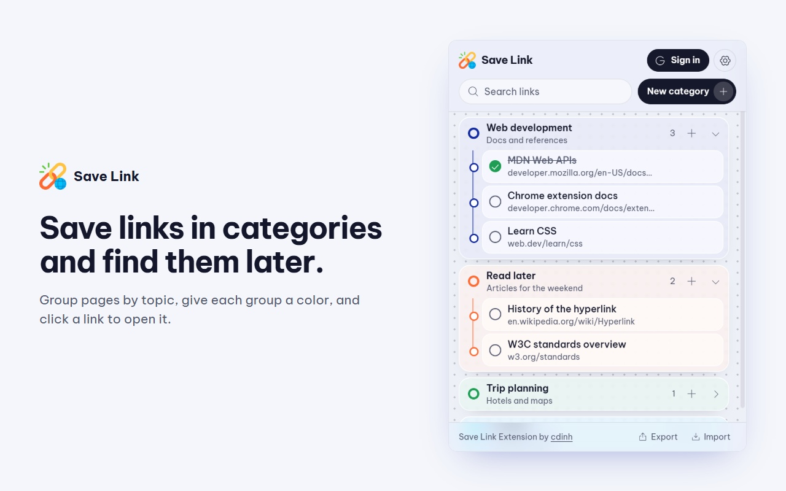

# Save Link

**Lưu link theo nhóm, tìm lại khi cần.**

[**Cài từ Chrome Web Store**](https://chromewebstore.google.com/detail/aadamanlgmnfnihadggllbllfiggllob) ·
[Trang chủ](https://cdinhh.github.io/Extension-Save-Link/) ·
[Quyền riêng tư](https://cdinhh.github.io/Extension-Save-Link/vi/privacy.html) ·
[Báo lỗi](https://github.com/CDinhh/Extension-Save-Link/issues)

## Tính năng

- Nhóm link theo màu, kéo thả để sắp xếp.
- Lưu trang đang xem bằng chuột phải hoặc nút **+** trong popup.
- Tìm theo tiêu đề hoặc địa chỉ.
- Đánh dấu đã xong, sửa, sao chép, xóa có hoàn tác.
- Đồng bộ (tùy chọn) qua một Google Sheet trong Drive của bạn.
- Giao diện sáng/tối, tiếng Việt và tiếng Anh, xuất/nhập JSON.

## Quyền riêng tư

Không có server riêng, không analytics. Khi đăng nhập, tiện ích chỉ tạo và sửa đúng một sheet **"Link Inventory Extension [Dont delete]"** trong Drive của bạn (quyền `drive.file`). Xem thêm ở [chính sách quyền riêng tư](https://cdinhh.github.io/Extension-Save-Link/vi/privacy.html).

## Giấy phép

MIT. Dùng [Phosphor](https://phosphoricons.com), [Be Vietnam Pro](https://github.com/bettergui/BeVietnamPro) và [SortableJS](https://github.com/SortableJS/Sortable).
